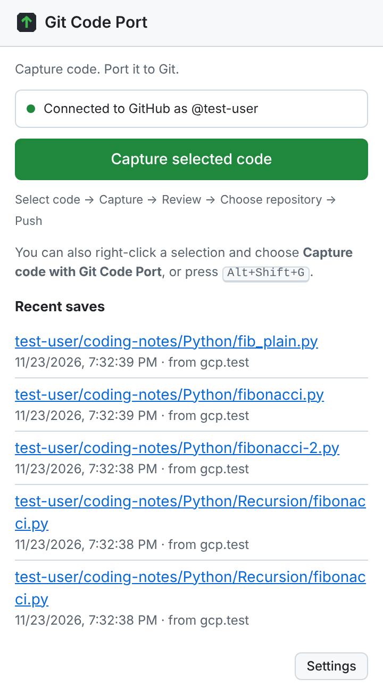
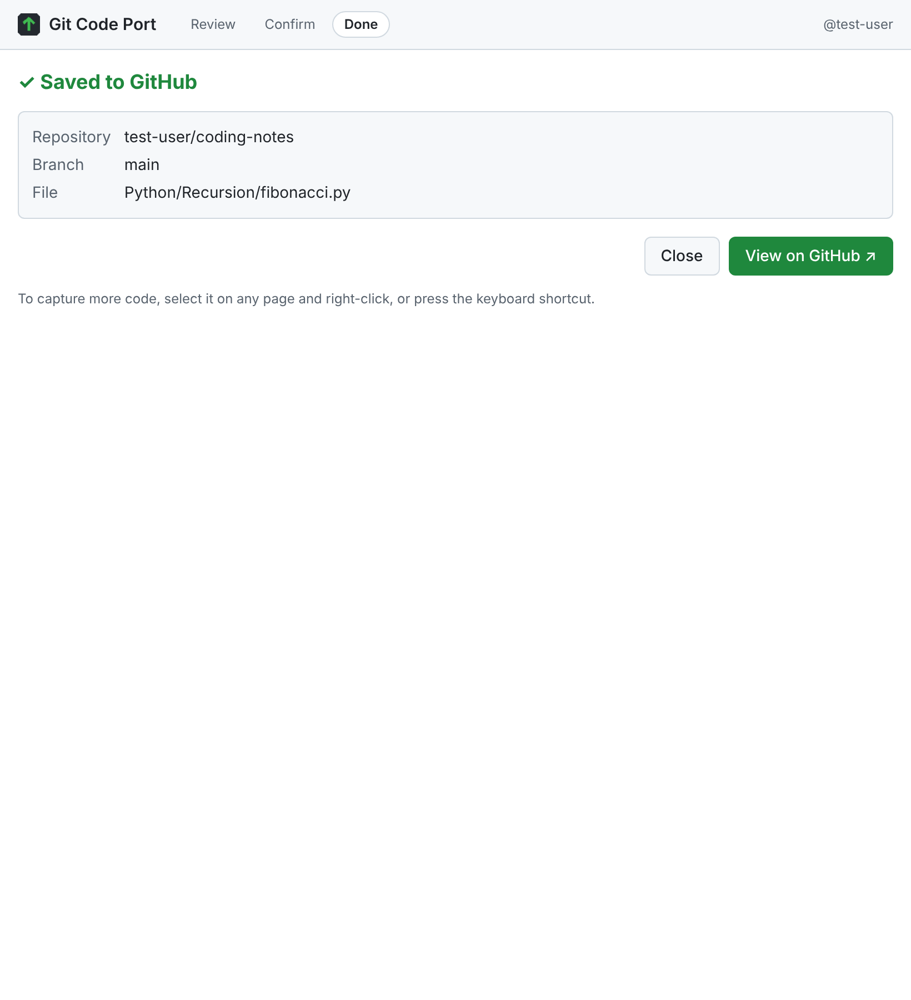
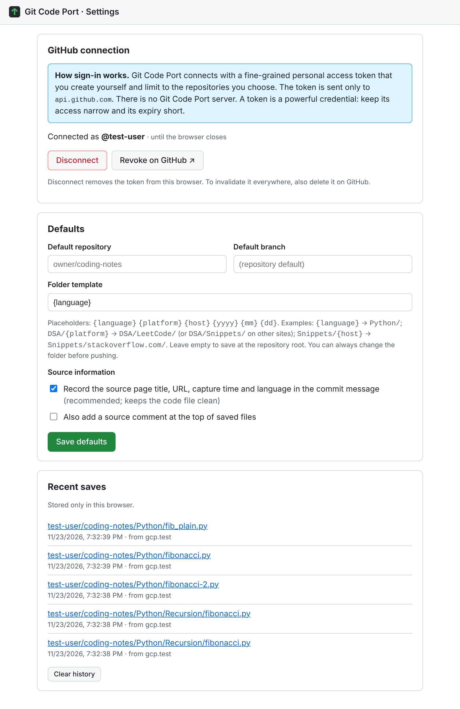

<div align="center">


# Git Code Port

**Capture code. Port it to Git.**

A lightweight browser extension that saves code you select on almost any webpage straight into your GitHub repository, after you review it.


</div>

---

## Table of contents

- [Overview](#overview)
- [Features](#features)
- [Demo](#demo)
- [How it works](#how-it-works)
- [Installation](#installation)
- [How to use](#how-to-use)
- [Architecture](#architecture)
- [Technology stack](#technology-stack)
- [Project structure](#project-structure)
- [Security and privacy](#security-and-privacy)
- [Permissions](#permissions)
- [Testing](#testing)
- [Troubleshooting](#troubleshooting)
- [Roadmap](#roadmap)
- [Contributing](#contributing)
- [License](#license)
- [Author](#author)
- [Acknowledgments](#acknowledgments)

## Overview

**Git Code Port** is a Chrome (Manifest V3) extension for developers and students who find useful code all over the web: problem solutions, tutorial snippets, documentation examples, answers from AI chat tools, blog posts. Copying that code into a local file, naming it, committing it and pushing it takes several context switches. Git Code Port turns it into one flow:

> **Select code → Capture → Review → Choose repository → Push**

**Why it exists.** Most code-saving tools are tied to one platform: a LeetCode syncer only understands LeetCode, a Gist tool only creates gists. Git Code Port does not use any website's API. It reads the text you highlighted, so it works the same way on coding platforms, documentation, blogs and AI-generated code pages.

**How it differs from platform-specific tools**

| | Platform-specific syncers | Git Code Port |
|---|---|---|
| Works on | One site | Almost any webpage you can select text on |
| What is saved | Whatever the site's API returns | Exactly what you select, after you review and edit it |
| Where it goes | Fixed folder layout | Any repository, branch, folder and filename you choose |
| Overwrites | Often automatic | Never without an explicit, two-step confirmation |

## Features

Everything listed here is implemented in this repository today. Planned work is in the [Roadmap](#roadmap).

**Capture**
- Right-click menu item **Capture code with Git Code Port** on any text selection.
- Toolbar popup button **Capture selected code** and a keyboard shortcut (**Alt+Shift+G** by default).
- Preserves indentation, tabs, blank lines and Unicode by reading the live selection. Selections inside text boxes and embedded frames are read too, where the browser allows it.
- Clear messages when nothing is selected or the page blocks extensions (for example `chrome://` pages or the Web Store).

**Review and edit**
- A review window where you can edit the code, change the language, filename, folder, branch and commit message, and add optional notes.
- A separate confirm screen that shows the exact repository, branch, path, commit message, size and final content before anything is sent.

**Language detection** for Python, Java, C, C++, JavaScript, TypeScript, HTML, CSS, SQL, Bash/Shell, JSON, YAML, Rust and Go, plus C#, Kotlin, Swift, PHP, Ruby, Dockerfile and Markdown. It combines code patterns with hints from the page (for example `class="language-python"`), shows a confidence label, falls back to plain text when unsure, and follows the extension when you rename the file.

**Filename suggestions** from, in order: the main function or class name in the code (Java uses the public class name so it compiles), then the problem or page title (`1. Two Sum - LeetCode` → `two_sum.py`), then `snippet`. Names are sanitized (no `/ \ : * ? " < > |`, control characters or leading dots, max 120 characters).

**Repository organization**
- Folder suggestions such as `Python`, `Java`, `C`, `CPP`, `JavaScript`, `DSA`, `LeetCode`, `GeeksForGeeks`, `Codeforces`, `Snippets`, or type any folder you like.
- A default folder template with placeholders: `{language}`, `{platform}` (LeetCode, GeeksForGeeks, Codeforces, HackerRank and others), `{host}`, `{yyyy}`, `{mm}`, `{dd}`.
- Remembers the last repository and branch you used.

**GitHub integration** (GitHub REST API, Contents API)
- Lists only repositories your token can push to, plus branch suggestions.
- Creates new files; checks that the branch exists first.
- **Never silently overwrites.** If the file exists, you see the current file and your capture side by side and choose: go back, save under a free name (`name-2.py`), or replace after a second explicit confirmation.
- Detects when the identical file is already on GitHub and skips a duplicate commit.

**Source information**
- Records source title, URL, capture time and language in the **commit message**, so your code file stays clean. This can be turned off.
- Optional source comment at the top of the file (off by default).
- Optional free-text notes added to the commit message.

**Safety**
- Warns about likely secrets (API keys, tokens, private keys, passwords) in the code and requires an explicit acknowledgement before pushing.
- Understandable errors for: no selection, restricted pages, invalid filename, path or branch, unknown repository, expired or revoked token, missing permission, rate limits, network failures, GitHub server errors, files that already exist, and unexpected extension errors.
- Recent saves list (last 20, stored only in your browser).

## Demo

The screenshots below are real captures of the extension UI. They were taken by the automated browser test (`npm run test:e2e -- --screenshots docs/screenshots`), which talks to a **mocked** GitHub API, so the account and repository shown (`test-user/coding-notes`) are test data.

| Popup | Review and edit |
|---|---|
|  |  |

| Confirm | File already exists |
|---|---|
|  |  |

| Saved | Settings |
|---|---|
|  |  |

> **Wanted:** a short GIF of the full flow on a real site (select → right-click → review → push → file on GitHub). Contributions welcome.

## How it works

1. **Browse** any website that shows code.
2. **Select** the code you want to keep.
3. **Capture** it: right-click the selection and choose **Capture code with Git Code Port**, click **Capture selected code** in the toolbar popup, or press **Alt+Shift+G**.
4. **Review** the captured code in the window that opens. Edit it if needed. The language, filename and folder are already suggested.
5. **Choose** the repository, branch, folder, filename and commit message.
6. **Confirm**: press **Review & push**, check the summary and final content, then press **Push to GitHub**.
7. If a file already exists at that path, **decide** what to do. Nothing is overwritten unless you confirm twice.
8. The code is **saved to GitHub** as a new commit, with a **View on GitHub** link.

## Installation

Git Code Port is not on the Chrome Web Store yet. Install it from source in a minute:

1. **Download the code.** Install [Git](https://git-scm.com/downloads) if you do not have it, then run:

   ```bash
   git clone https://github.com/ikaustav/Git-Code-Port.git
   ```

   This creates a `Git-Code-Port` folder. (No Git? On the GitHub page, choose **Code → Download ZIP** and unzip it.)

2. **Open the extensions page.** In Chrome, go to `chrome://extensions` (Edge: `edge://extensions`, Brave: `brave://extensions`).
3. **Turn on Developer mode** with the switch in the top-right corner.
4. **Click Load unpacked.**
5. **Select the `Git-Code-Port` folder**, the one that contains `manifest.json`.
6. **Pin the extension** (optional but handy): click the puzzle-piece icon in the toolbar and pin **Git Code Port**.

The Settings page opens automatically after installing. There is nothing to build: no `npm install` is needed to use the extension.

**Requirements:** Chrome, Edge, Brave or another Chromium browser, version 116 or newer.

**Updating:** run `git pull` in the folder, then press the reload icon on the Git Code Port card in `chrome://extensions`.

## How to use

### 1. Connect GitHub (once)

Git Code Port uses a **fine-grained personal access token** that you create and control.

1. Open the extension's **Settings** (toolbar popup → **Settings**, or right-click the toolbar icon → **Options**).
2. Click **GitHub → New fine-grained token**. On GitHub:
   - **Repository access:** choose **Only select repositories** and pick the repositories you want to save code to.
   - **Repository permissions → Contents:** set to **Read and write**. (Metadata: Read-only is added automatically.)
   - Choose a **short expiration**, then **Generate token** and copy it.
3. Paste the token into Settings and click **Connect**. You should see *Connected as @your-name*.
4. Optional: tick **Remember on this device** to keep the token after the browser closes (see [Security and privacy](#security-and-privacy) for the trade-off).

### 2. Capture code

Select code on a page, then use any one of:

- **Right-click → Capture code with Git Code Port** (most reliable; works in more places).
- **Toolbar popup → Capture selected code.**
- **Alt+Shift+G** (change it at `chrome://extensions/shortcuts`).

A review window opens with your code.

### 3. Edit the code, language and filename

- Edit the code directly in the **Captured code** box. **Tab** inserts a tab; press **Esc** and then **Tab** to leave the box.
- Change the **Language** if the guess is wrong; the filename extension follows. Renaming the file to `.ts`, `.go` and so on updates the language too.
- Change the **Filename** freely. Invalid characters are cleaned up when you leave the field.

### 4. Choose repository, branch and folder

- **Repository** lists repositories the token can push to. Press **↻** to reload after changing token access.
- **Branch** defaults to your last-used or the repository's default branch; suggestions appear as you type. The branch must already exist.
- **Folder** offers suggestions (`Python`, `DSA`, `LeetCode`, `Snippets`…) or type a path like `DSA/Graphs`. Leave it empty for the repository root.
- The line **Saves to …** always shows the exact destination.

### 5. Add notes and source information (optional)

Open **Source and notes** to see the page title, URL and capture time, write notes for the commit message, and choose whether to record the source in the commit and/or add a source comment to the file.

### 6. Push

Press **Review & push →** (or **Ctrl/Cmd+Enter**), check the confirm screen, then press **Push to GitHub**. On success, use **View on GitHub** to open the file.

### 7. When the file already exists

You will see the current file and your capture side by side. Nothing has been changed yet. Choose:

- **Back to edit** to pick a different name or folder yourself.
- **Save as a new file**: finds a free name such as `fibonacci-2.py` and shows the confirm screen again.
- **Replace the existing file…**: asks you to tick a confirmation box, then updates the file. The previous version stays in Git history.

### 8. Settings and defaults

In Settings you can set a default repository and branch, a folder template (for example `DSA/{platform}` or `{language}`), the source-information options, view recent saves, clear history, and **Disconnect** (removes the token from the browser; also revoke it on GitHub to invalidate it everywhere).

## Architecture

Plain ES modules, no build step and no runtime dependencies. Each part of the extension has one job:

```
 Web page                 Service worker               Review window                 GitHub
 ────────                 ──────────────               ─────────────                 ──────
 user selects code ──►  context menu / shortcut /
                        popup message
                        └─ capture.js reads the
                           selection (scripting API,
                           text only)
                        └─ stores it in session
                           storage, opens window  ──►  review.js
                                                       ├─ languages.js  detect language
                                                       ├─ filename.js   names, folders, commit text
                                                       ├─ secret-scan.js warn about secrets
                                                       ├─ validation.js  path/branch/content checks
                                                       └─ api.js ─────────────────────────►  REST API
                                                          (token from settings.js)          (Contents API)
```

| File | Role |
|---|---|
| `manifest.json` | MV3 manifest: permissions, service worker, popup, options page, shortcut, Content Security Policy. |
| `src/background/service-worker.js` | Registers the context menu and shortcut, accepts capture requests only from the extension's own pages, opens the review window. Never sees the token. |
| `src/capture/capture.js` | Reads the selection from the tab with `chrome.scripting` (plain text plus a language hint), handles restricted pages and empty selections, stores captures in session storage with a 6-hour expiry. |
| `src/review/review.{html,js,css}` | The Review → Confirm → Done flow, conflict handling and all user-facing errors. |
| `src/github/api.js` | Small GitHub REST client: list repositories and branches, read and create/update files, map HTTP errors (401, 403, 404, 409, 422, 429, 5xx, network) to friendly messages. Retries safe GET requests; never retries writes. |
| `src/processing/languages.js` | Language list and heuristic detection with confidence levels. |
| `src/processing/filename.js` | Filename, folder template (`{platform}` etc.), commit message and metadata suggestions. |
| `src/processing/secret-scan.js` | Heuristic secret detection with masked previews. |
| `src/utils/validation.js` | Filename sanitizing and path, branch and size validation. |
| `src/utils/encoding.js` | UTF-8 safe Base64 for the Contents API, newline normalization. |
| `src/storage/settings.js` | Settings, token storage, history and a short-lived repository cache. |
| `src/popup/*` | Toolbar popup: status, capture button, recent saves. |
| `src/options/*` | Settings page: token connection, defaults, history. |
| `src/ui/*` | Shared styles (light and dark) and the history list renderer. |
| `scripts/check.mjs` | Static checks: manifest rules, referenced files, JS syntax, unsafe APIs, accidental secrets. |
| `scripts/package.sh` | Builds a ZIP containing only the files the browser needs. |
| `tests/` | Unit tests (Node test runner) and an end-to-end test that loads the extension in Chromium with a mocked GitHub API. |

## Technology stack

- **JavaScript** (ES modules, no framework, no runtime dependencies)
- **HTML** and **CSS** (system fonts, light and dark themes)
- **Chrome Extension APIs**: `contextMenus`, `scripting`, `storage`, `commands`, `action`, `windows`, `runtime`
- **Manifest V3** (service worker background)
- **GitHub REST API** (`/user`, `/user/repos`, branches, Contents API) with API version `2022-11-28`
- Development only: **Node.js** test runner and **Playwright** with Chromium for browser tests

## Project structure

```
Git-Code-Port/
├── manifest.json               # Extension manifest (MV3)
├── package.json                # npm scripts for checks and tests (no dependencies)
├── assets/
│   └── icons/                  # 16, 32, 48 and 128 px icons
├── docs/
│   └── screenshots/            # README screenshots (from the e2e test, mocked API)
├── scripts/
│   ├── check.mjs               # Static validation
│   └── package.sh              # Builds dist/git-code-port-<version>.zip
├── src/
│   ├── background/
│   │   └── service-worker.js   # Menu, shortcut, popup messages
│   ├── capture/
│   │   └── capture.js          # Selection reading and capture storage
│   ├── github/
│   │   └── api.js              # GitHub REST client
│   ├── options/                # Settings page
│   │   ├── options.css
│   │   ├── options.html
│   │   └── options.js
│   ├── popup/                  # Toolbar popup
│   │   ├── popup.html
│   │   └── popup.js
│   ├── processing/
│   │   ├── filename.js         # Names, folders, commit messages
│   │   ├── languages.js        # Language detection
│   │   └── secret-scan.js      # Secret warnings
│   ├── review/                 # Review → Confirm → Done window
│   │   ├── review.css
│   │   ├── review.html
│   │   └── review.js
│   ├── storage/
│   │   └── settings.js         # Settings, token, history
│   ├── ui/
│   │   ├── common.css          # Shared styles
│   │   └── history.js          # Recent saves list
│   └── utils/
│       ├── encoding.js         # UTF-8 Base64
│       └── validation.js       # Path, branch, filename checks
└── tests/
    ├── e2e.js                  # Chromium end-to-end test (mocked GitHub)
    └── unit.test.js            # Unit tests
```

## Security and privacy

This section describes what the code actually does. A security review was carried out while preparing this version (see the checks below), but **no software is guaranteed secure**, and the token model has real limitations, described honestly here.

**What data is collected.** Git Code Port has **no server, no analytics and no telemetry**. It only handles:

| Data | Where it is kept | Sent to |
|---|---|---|
| Captured code, page title and URL | `chrome.storage.session` (memory) until you save, close or after 6 hours | GitHub, only when you press **Push** |
| GitHub token | `chrome.storage.session` by default; also `chrome.storage.local` if you tick **Remember** | `api.github.com` only, in the `Authorization` header |
| Settings and last-used repo/branch | `chrome.storage.local` | Nowhere |
| Recent saves (repo, path, GitHub URL, source URL, time; last 20) | `chrome.storage.local` | Nowhere |
| Repository list cache (names only, 10 minutes) | `chrome.storage.local` | Nowhere |

**What is sent to GitHub.** The file content you confirmed, its path, the branch, and the commit message (which by default includes the source title, URL, capture time, language and your notes). If the repository is public, **all of this becomes public**. Turn off source information in the review screen or Settings if you do not want the page URL in your commit history.

**Authentication.** You paste a fine-grained personal access token. It is checked against `GET /user`, never shown again in the UI, never put in URLs, never logged (the code contains no `console` calls; `npm run check` enforces this) and only sent to `https://api.github.com` (also enforced by the Content Security Policy `connect-src`). **Disconnect** removes it from the browser.

**Limitations you should know about.**
- A remembered token in `chrome.storage.local` is **not encrypted at rest**. Anyone with access to your browser profile on disk could read it. Leave **Remember** unticked on shared computers.
- A token is a bearer credential: whoever has it can act with its permissions until it expires or is revoked. Limit it to the repositories you need, grant only **Contents: Read and write**, and set a short expiry.
- **Is this suitable for a publicly distributed extension?** It is acceptable for personal use and small-scale distribution, because each user controls their own narrowly scoped token. For a Chrome Web Store release, a **GitHub App with the OAuth device flow** would be better: users would not handle raw tokens, tokens would be short-lived and refreshable, and access could be granted per repository from GitHub's UI. That requires registering a GitHub App and is on the [Roadmap](#roadmap).
- The secret warning is a **heuristic**. It can miss secrets and can flag harmless text.
- Captured code is saved as text and never executed by the extension, but code you save from the web can still be malicious if **you** run it later.

**Protections in the code.**
- Captured page content is treated as untrusted: it is only placed in form values or `textContent`, never `innerHTML`, never evaluated, never executed. The e2e test checks that an `` / `<script>` selection is shown as text.
- No `eval`, `new Function`, `innerHTML`, `document.write` or inline scripts (enforced by `npm run check` and the MV3 CSP: `script-src 'self'; object-src 'none'; base-uri 'none'`).
- No content scripts are injected permanently. The selection is read once, on your action, with `activeTab`.
- The service worker accepts capture messages only from the extension's own pages; there is no `externally_connectable`, so websites cannot message the extension.
- Inputs are validated before any API call: repository format, branch name rules, path segments (`..`, `.git`, reserved characters), filename sanitizing, 1 MB content limit.
- Links shown after saving and in history only ever point to `https://github.com/`.
- Writes (PUT) are never retried automatically, to avoid duplicate commits; existing files need an explicit two-step confirmation and the file's SHA, so a file that changed in the meantime is not overwritten.
- No third-party dependencies are shipped, so there is no dependency supply chain in the extension itself.

## Permissions

| Permission | Why it is needed |
|---|---|
| `contextMenus` | Adds **Capture code with Git Code Port** to the right-click menu for selected text. |
| `activeTab` | Grants temporary access to the current tab **only after you act** (menu click, popup button or shortcut), so the selection can be read. No access to your browsing otherwise. |
| `scripting` | Runs a small, read-only function in that tab to read the selection with its original line breaks and indentation. |
| `storage` | Keeps settings, history, the current capture and the token (see the table above). |
| Host: `https://api.github.com/*` | Lets the extension call the GitHub REST API. No other site is contacted. |

The extension does **not** request `tabs`, `<all_urls>`, `history`, `cookies`, `webRequest` or `notifications`. (The e2e test adds `<all_urls>` to a temporary copy of the manifest only because a real right-click cannot be simulated headlessly; the shipped manifest does not include it.)

## Testing

```bash
npm run check        # static checks: manifest, files, syntax, unsafe APIs, secrets
npm test             # unit tests (Node 18+)
npm run test:e2e     # browser test: needs Playwright + Chromium (npm i -D playwright && npx playwright install chromium)
```

**What the automated tests cover:** language detection for all listed languages, filename/folder/title/metadata rules, path, branch and filename validation, UTF-8 Base64, GitHub error mapping and retry rules, request structure (URL encoding, SHA, `Authorization` header). The end-to-end test loads the extension into Chromium and checks capture with exact indentation, suggestions, invalid-path blocking, the confirm screen, file creation and commit message, duplicate detection, conflict handling (save as new / two-step replace), metadata opt-out, empty selections, the popup's restricted-page error, missing branch, secret blocking, XSS safety, revoked tokens and the Settings connect/disconnect flow.

**Not covered by automated tests:** a real right-click (the test calls the same handler directly), the keyboard shortcut press, the popup capturing a real page (the shared capture path is tested), and pushes to the real GitHub API (the API is mocked). Please report anything that behaves differently on a real site.

## Troubleshooting

| Problem | What to do |
|---|---|
| **Extension not appearing** | Check that you selected the folder containing `manifest.json` in **Load unpacked**, that Developer mode is on, and that your browser is Chromium 116+. Look for an **Errors** button on the extension card. |
| **Context menu item missing** | The item only appears when text is selected. It does not appear on `chrome://` pages, the Chrome Web Store or inside the built-in PDF viewer. After updating the code, press reload on the extension card. |
| **Code not captured / "No code selected"** | Make sure the text is highlighted before capturing. Some editors (for example Monaco or CodeMirror) only render visible lines, so select inside the editor and use their own select-all, or copy into a plain page. If a blue note says line breaks may be lost, the page blocked direct reading; check the indentation before pushing. |
| **Shortcut does nothing** | Another extension may use **Alt+Shift+G**. Set a different one at `chrome://extensions/shortcuts`. |
| **"GitHub rejected the token"** | The token expired, was revoked or was mistyped. Create a new one and reconnect in Settings. |
| **"Permission denied"** | The token lacks **Contents: Read and write** for that repository, or the repository is not in its selected list. Edit the token on GitHub. Organization repositories may also need the organization to approve fine-grained tokens. |
| **Push failure / "Branch does not exist"** | The branch must already exist. Pick one from the suggestions or create it on GitHub first. |
| **File already exists** | Choose **Save as a new file**, change the name/folder, or **Replace** after confirming. Nothing is changed until you decide. |
| **Repository not loading / list empty** | Press **↻** next to Repository. The list shows only non-archived repositories the token can push to. If you just changed token access, reconnect in Settings. |
| **"Rate limit reached"** | GitHub limits API calls per hour. Wait until the time shown and try again. |
| **"Could not reach GitHub"** | Check your internet connection, VPN or firewall. Your capture is kept; press **Try again**. |

## Roadmap

**Done (v0.1.0)**
- [x] Context-menu, popup and keyboard-shortcut capture with exact indentation
- [x] Review, edit and confirm before pushing
- [x] Language detection with confidence and manual override
- [x] Filename, folder (`{platform}`, `{language}`…) and commit message suggestions
- [x] Safe create, duplicate detection and explicit replace / save-as-new on conflicts
- [x] Configurable source metadata and notes in the commit message
- [x] Secret warnings, input validation and friendly error messages
- [x] Static checks, unit tests and a Chromium end-to-end test

**Planned**
- [ ] Sign in with a GitHub App (OAuth device flow) instead of a personal access token
- [ ] Create a new branch from the review screen
- [ ] Optional sidecar metadata file (for example `README` index per folder)
- [ ] Syntax highlighting in the preview, without a heavy dependency
- [ ] Firefox support (Manifest V3 differences in `storage.session` and `scripting`)
- [ ] Chrome Web Store release
- [ ] Demo GIF on a real site

## Contributing

Contributions are welcome. To keep the extension light, please avoid adding frameworks, build tools or runtime dependencies unless there is a clear need.

1. **Fork** this repository on GitHub and clone your fork:
   ```bash
   git clone https://github.com/<your-username>/Git-Code-Port.git
   cd Git-Code-Port
   ```
2. **Create a branch** for your change:
   ```bash
   git checkout -b fix/short-description
   ```
3. **Make your changes.** Load the folder with **Load unpacked** and press reload on the extension card after each edit.
4. **Test:**
   ```bash
   npm run check && npm test
   npm run test:e2e   # if you changed capture, review, popup or settings
   ```
5. **Commit** with a clear message (`feat: …`, `fix: …`, `docs: …`, `security: …`, `refactor: …`) and push your branch.
6. **Open a pull request** describing what changed, why, and how you tested it. Never include tokens or other credentials in code, tests, screenshots or issues.

Found a security problem? Please report it privately to the maintainer rather than in a public issue.

## License

No license has been chosen for this repository yet, which means that by default the author keeps all rights. If you want others to use, modify and share the code, the maintainer can add a `LICENSE` file (MIT is a common choice for small developer tools).

## Author

Created and maintained by **[@ikaustav](https://github.com/ikaustav)** on GitHub.

## Acknowledgments

- [GitHub REST API documentation](https://docs.github.com/en/rest), in particular the [repository contents endpoints](https://docs.github.com/en/rest/repos/contents).
- [Chrome Extensions documentation](https://developer.chrome.com/docs/extensions) for Manifest V3.
- Everyone who keeps their best snippets in Git.
