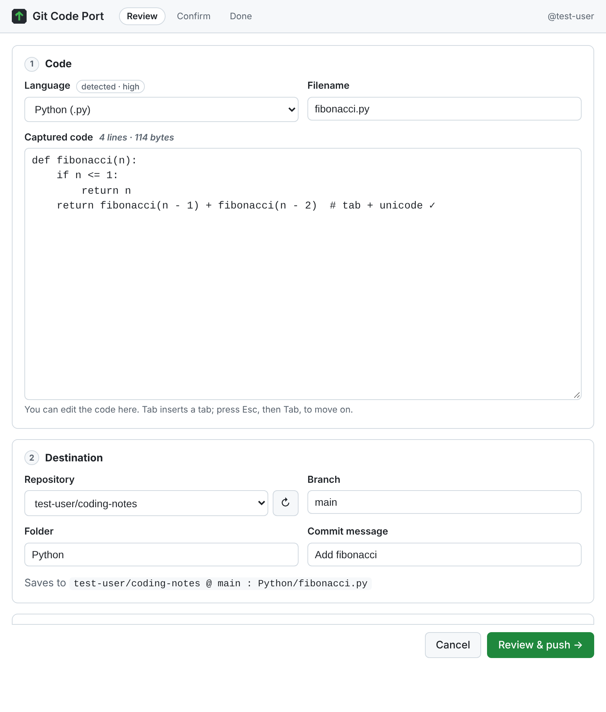
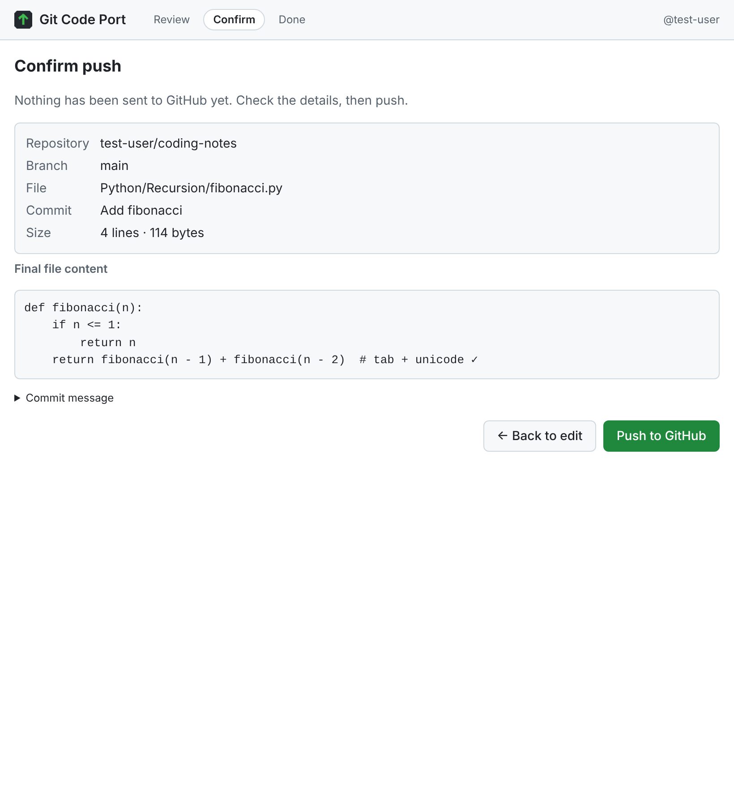
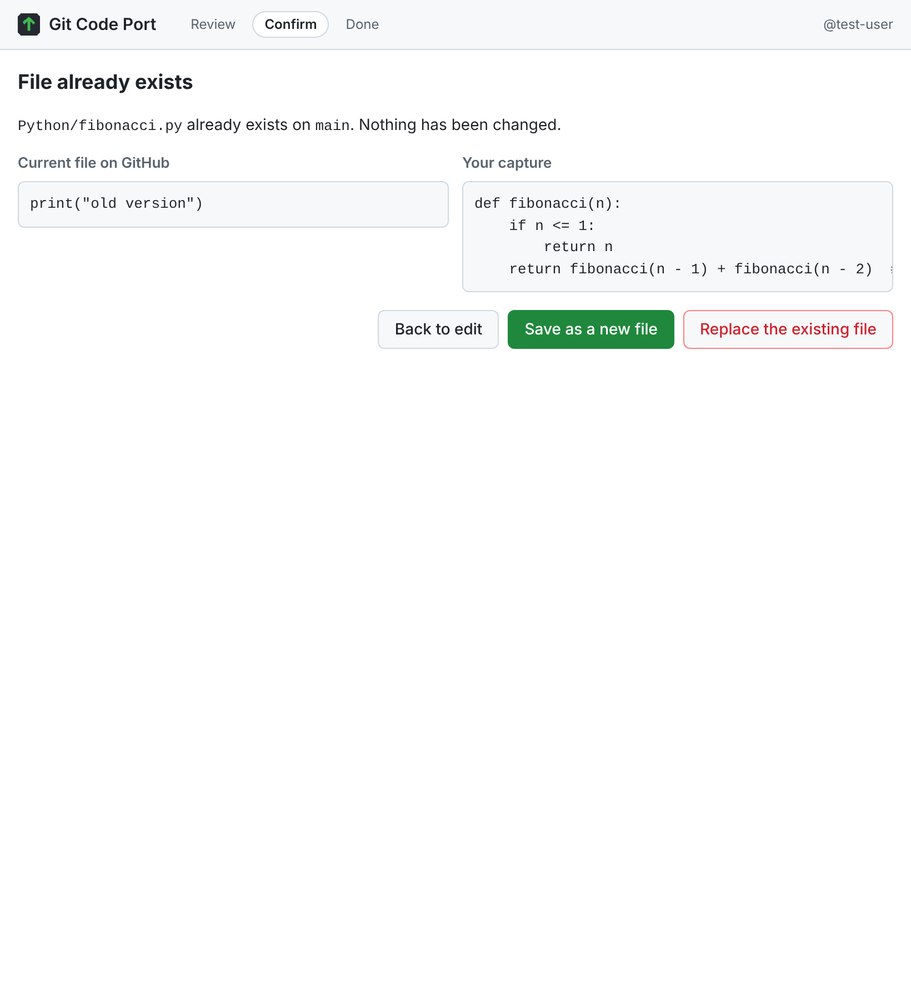
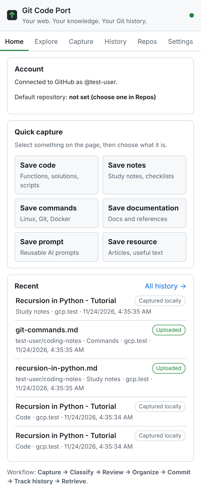
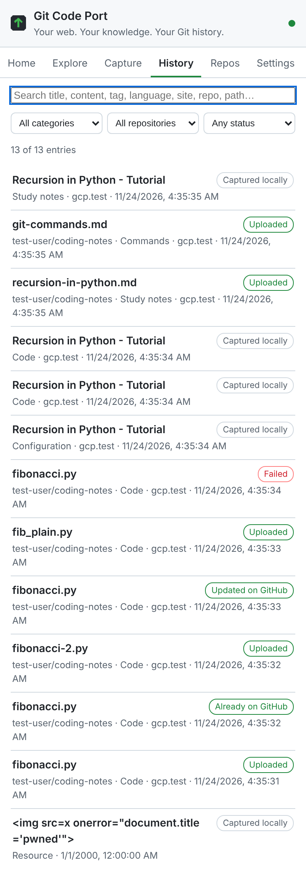
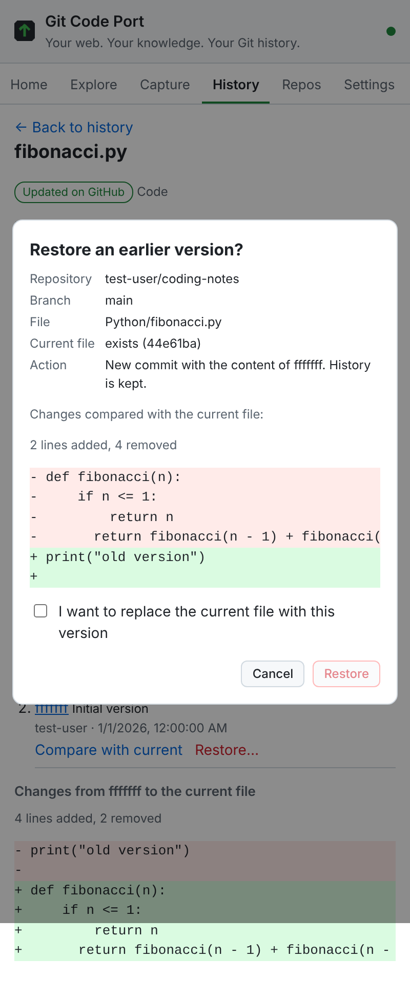
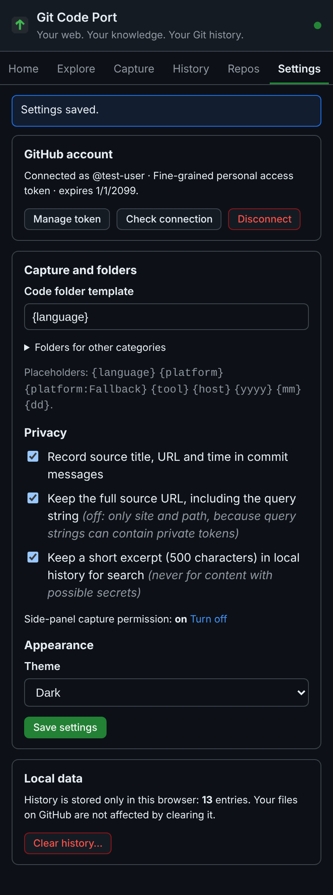

<div align="center">


# Git Code Port

**Your web. Your knowledge. Your Git history.**

Capture code, notes, commands, prompts and research from almost any webpage, review it, and save it to your own GitHub repositories, with version history you control.


</div>

---

**What it does.** Select anything on a page, choose *Git Code Port* from the right-click menu, check the suggested category, filename and folder, and commit it to GitHub. Find it again later in the side panel's searchable history, compare versions and restore older ones.

**Why you can trust it.** No server, no analytics, no AI service. Your files and history live in **your GitHub repositories**; the extension keeps only settings and a small local index. Nothing is written to GitHub without you confirming it, existing files are never overwritten silently, and webpage content is never executed. Every feature is backed by automated tests: see the [test report](docs/TEST_REPORT.md) and the [security audit](SECURITY_AUDIT.md).

**How to use it.** [Install](#installation) → [connect a token](#1-connect-github) → select → right-click → review → push.

## Contents

[Overview](#overview) · [Features](#features) · [Content categories](#supported-content-categories) · [Use cases](#website-use-cases) · [Side panel](#side-panel-walkthrough) · [Installation](#installation) · [How to use](#how-to-use) · [Authentication](#github-authentication) · [Version history](#version-history) · [Organization](#repository-organization) · [Architecture](#architecture) · [Tech stack](#technology-stack) · [Structure](#project-structure) · [Security and privacy](#security-and-privacy) · [Permissions](#permissions) · [Testing](#testing-and-test-report) · [Troubleshooting](#troubleshooting) · [Screenshots](#screenshots) · [Future scope](#future-scope) · [Contributing](#contributing) · [License](#license) · [Author](#author)

## Overview

**The problem.** Useful knowledge is scattered across the web: a solution on LeetCode, a command on Stack Overflow, a paragraph in MDN, a prompt that finally worked, a paper abstract. Bookmarks rot, copy-paste into a notes app loses context, and platform-specific syncers only work on one site.

**The vision.** A lightweight, universal web-to-GitHub capture tool and personal version-control workspace:

> **Capture → Classify → Review → Organize → Commit → Track history → Retrieve**

GitHub is the source of truth for your files and their history. Git Code Port is the bridge: it captures, suggests how to file it, asks you to confirm, commits it, and helps you find and manage it later. It does not try to be a cloud storage platform.

## Features

Every feature below is implemented and covered by automated tests ([test report](docs/TEST_REPORT.md)).

**Capture**
- Right-click menu **Git Code Port** with *Save selection (auto-detect)*, *Save as code*, *notes*, *commands*, *documentation*, *AI prompt* and *resource*.
- Toolbar popup button, keyboard shortcut (**Alt+Shift+G**), and quick-capture buttons in the side panel.
- Preserves indentation, tabs, blank lines and Unicode. Never captures the whole page; only your selection, only when you act.
- Clear messages for empty selections, restricted pages (`chrome://`, Web Store, PDF viewer) and selections over 1 MB (refused, never truncated).

**Classify and review**
- Local classifier (no network) that suggests a **category**, **language**, **format**, **filename**, **folder** and **tags**. You can override every suggestion.
- Language detection for Python, Java, C, C++, JavaScript, TypeScript, HTML, CSS, SQL, Bash, JSON, YAML, Rust, Go, plus C#, Kotlin, Swift, PHP, Ruby, Dockerfile and Markdown.
- Formats: source file with its real extension, Markdown as-is, Markdown with the text in a code block, or plain text. The confirm screen shows the exact final bytes.
- Editable content, notes for the commit message, possible-secret warnings (content and notes) that must be acknowledged before pushing.

**Commit safely**
- Creates files via the GitHub Contents API after an explicit confirm step.
- If the file exists: a line-by-line **diff**, then *save as a new file* or *replace* after a second confirmation, sending the file's SHA so a newer change on GitHub is never overwritten.
- Detects when the identical file is already there (no empty commit) and warns when you saved identical content before anywhere else.
- Success is recorded only after GitHub returns a valid commit SHA for the right path.

**History and retrieval (side panel)**
- Local index of captures with clear states: *Captured locally*, *Pending upload*, *Uploaded*, *Updated*, *Restored*, *Already on GitHub*, *Failed*, *Conflict detected*.
- Search by title, content excerpt, category, tag, language, source site, repository or path; filter by category, repository and status.
- Per-file **version list** from GitHub, **compare** any version with the current file, **restore** an earlier version (new commit, confirmation required).
- *Continue review* for captures you have not pushed yet (while the capture is still in the browser session).

**Organization**
- Category folders such as `Coding/LeetCode`, `Developer-Tools/Git`, `Database/SQL`, `Learning/Notes`, `AI/Prompts`, `Research`, all customizable.
- Placeholders: `{language}`, `{platform}`, `{platform:Fallback}`, `{tool}`, `{host}`, `{yyyy}`, `{mm}`, `{dd}`.
- Default repository, per-repository default branch and base folder, tags in commit messages and the index.

## Supported content categories

| Category | Typical content | Default folder | Default file |
|---|---|---|---|
| Code | Functions, classes, scripts | `{language}` (e.g. `Python/`) | `fibonacci.py` (from the code) |
| DSA / problem solving | LeetCode/Codeforces solutions | `Coding/{platform:DSA}` | `two_sum.cpp` (from the problem title) |
| Commands | Linux, Git, Docker, Kubernetes | `Developer-Tools/{tool}` | `git-commands.md` (code block) |
| SQL | Queries, schemas | `Database/SQL` | `query.sql` |
| Configuration | JSON, YAML, Dockerfile, INI | `Developer-Tools/Config` | `config.json`, `Dockerfile` |
| Study notes | Notes, checklists, lists | `Learning/Notes` | `notes.md` or `<page-title>.md` |
| Documentation | MDN, official docs excerpts | `Learning/Docs` | `<page-title>.md` |
| Research | Abstracts, citations | `Research` | `research.md` |
| AI prompt | Reusable prompts | `AI/Prompts` | `prompt-<first-words>.md` |
| Resource | Articles, useful paragraphs | `Resources/Articles` | `<page-title>.md` |

## Website use cases

Git Code Port uses ordinary text selection, so it works on almost any site. The sites below are **examples, not official integrations**.

- **Coding practice:** LeetCode, GeeksforGeeks, Codeforces, CodeChef, HackerRank, AtCoder. Save accepted solutions; the folder and filename come from the site and problem title.
- **Learning:** MDN, Stack Overflow, official docs, tutorials, blogs. Keep the explanation and a link back.
- **AI and productivity:** code and explanations from AI assistants, a versioned prompt library. Captured code is never run.
- **Developer toolbox:** commands, SQL, JSON/YAML, Docker files, regular expressions.
- **Everyday knowledge:** articles, checklists, research notes.

Some editors (Monaco, CodeMirror) render only visible lines; select inside them with their own select-all first.

## Side panel walkthrough

Open it from the toolbar popup with **Open workspace (side panel)**.

| View | What you can do |
|---|---|
| **Home** | Connection status, default repository, quick capture, the five most recent items. |
| **Explore** | Use-case cards with a one-click capture button for each. |
| **Capture** | Six quick actions (code, notes, commands, documentation, prompt, resource). The first time, Chrome asks for the optional permission described under [Permissions](#permissions). |
| **History** | Search and filter everything you captured; open an item for details, *View on GitHub*, *Show versions*, *Compare*, *Restore…*, *Continue review* or *Remove from history*. |
| **Repos** | Repositories your token can push to; make one the default; set a default branch and base folder per repository. |
| **Settings** | Account, token type and expiry with warnings, disconnect, folder templates per category, privacy options, side-panel permission, theme, clear history. |

## Installation

Install from source:

1. **Get the code**
   ```bash
   git clone https://github.com/ikaustav/Git-Code-Port.git
   ```
   (No Git? Use **Code → Download ZIP** on GitHub and unzip it.)
2. Open `chrome://extensions` (Edge: `edge://extensions`, Brave: `brave://extensions`).
3. Turn on **Developer mode** (top right).
4. Click **Load unpacked** and choose the `Git-Code-Port` folder (the one with `manifest.json`).
5. Optional: pin **Git Code Port** from the puzzle-piece menu.

No build step and no `npm install` are needed to use it. Requires Chromium 116 or newer. To update: `git pull`, then press reload on the extension card.

## How to use

### 1. Connect GitHub
1. Open **Settings** (toolbar popup → *Settings*).
2. Click **GitHub → New fine-grained token**. Choose **Only select repositories**, set **Repository permissions → Contents: Read and write**, pick a short expiration, generate it.
3. Paste it and click **Connect**. The side panel's Settings view shows the token type and expiry.

### 2. Capture
Select content, then right-click → **Git Code Port** → *Save selection (auto-detect)* or a specific type. Or use the toolbar button, **Alt+Shift+G**, or the side panel.

### 3. Review and organize
In the review window check **Category**, **Language**, **Save as**, **Filename**, **Tags**, **Repository**, **Branch**, **Folder** and **Commit message**. Edit the content if needed. Open **Source and notes** to add notes and choose what source information goes into the commit.

### 4. Commit
Press **Review & push →** (or Ctrl/Cmd+Enter). The confirm screen shows the destination, the final file content and the commit message. Press **Push to GitHub**.

### 5. Handle existing files
You see what would change. Choose **Back to edit**, **Save as a new file** (e.g. `notes-2.md`), or **Replace the existing file…** and tick the confirmation. The old version stays in Git history.

### 6. Find and manage later
Side panel → **History**: search, filter, open an item, **Show versions**, **Compare with current**, **Restore…**.

## GitHub authentication

| | |
|---|---|
| Mechanism | Fine-grained personal access token that you create and paste in Settings |
| Recommended scope | Only selected repositories; *Contents: Read and write* (Metadata read is automatic) |
| Validation | Checked with `GET /user` on connect; type and expiry read from response headers; classic tokens and tokens without expiry trigger warnings |
| Storage | `chrome.storage.session` (memory only, extension pages only) by default; `chrome.storage.local` **unencrypted** if you tick *Remember* |
| Where it is sent | Only `https://api.github.com`, in the `Authorization` header. Never in URLs, logs, messages or commits |
| Expired / revoked | Any 401 shows a reconnect prompt |
| Disconnect | Removes the token from both storage areas and clears the repository cache. Revoke it on GitHub to invalidate it everywhere |

A one-click **GitHub App sign-in** (device flow, short-lived tokens) is designed in [SECURITY_AUDIT.md §5](SECURITY_AUDIT.md#5-authentication-review-and-recommended-production-design) and listed under [Future scope](#future-scope).

## Version history

Git Code Port uses normal Git commits through the GitHub API, so every save is a real commit you can see on GitHub.

- **Create:** new file, new commit.
- **Update:** only after you see the diff and confirm twice; sends the current SHA, so if the file changed on GitHub in the meantime the update is rejected and re-checked, not forced.
- **Versions:** History → item → *Show versions* lists the commits that touched the file on that branch.
- **Compare:** any earlier version against the current file.
- **Restore:** writes the earlier content as a **new** commit (`Restore <file> to <sha>`). Nothing is deleted from history.

## Repository organization

Suggested layout (nothing is enforced; change any folder per capture or in Settings):

```text
Python/ Java/ CPP/ …          # Code by language
Coding/LeetCode/ Coding/Codeforces/ Coding/DSA/
Developer-Tools/Linux/ Developer-Tools/Git/ Developer-Tools/Docker/ Developer-Tools/Config/
Database/SQL/
Learning/Notes/ Learning/Docs/
Research/
AI/Prompts/
Resources/Articles/
```

Tags appear in the commit message (`Tags: python, recursion`) and in local search.

## Architecture

Plain ES modules, no framework, no build step, no runtime dependencies. Details in [docs/ARCHITECTURE.md](docs/ARCHITECTURE.md).

```
 Web page ──(user action)──► Service worker ──► Review window ──(confirm)──► GitHub REST API
   selection read once        menu / shortcut      classify, edit,           Contents + Commits
   via chrome.scripting       / validated msgs     diff, push                 (source of truth)
                                    │                    │
                                    ▼                    ▼
                         chrome.storage.session   chrome.storage.local ◄── Side panel
                         (capture buffer, token)  (settings, index)        history, versions, restore
```

## Technology stack

JavaScript (ES modules) · HTML · CSS · Chrome Extension APIs (`contextMenus`, `scripting`, `storage`, `sidePanel`, `permissions`, `commands`, `action`, `windows`, `runtime`) · Manifest V3 · GitHub REST API (API version `2022-11-28`) · Web Crypto (SHA-256 for duplicate detection). Development only: Node.js test runner, Playwright + Chromium, GitHub Actions, CodeQL.

## Project structure

```
Git-Code-Port/
├── manifest.json                 # MV3 manifest
├── package.json / package-lock.json  # dev tooling only (Playwright)
├── README.md  SECURITY.md  SECURITY_AUDIT.md  CHANGELOG.md
├── .github/
│   ├── workflows/ci.yml          # checks, unit + e2e tests, audit, package
│   ├── workflows/codeql.yml      # CodeQL security analysis
│   └── dependabot.yml
├── assets/icons/
├── docs/
│   ├── TEST_REPORT.md            # every automated test and its result
│   ├── ARCHITECTURE.md  PROJECT_AUDIT.md  IMPLEMENTATION_PLAN.md
│   └── screenshots/              # from the e2e test (mocked GitHub API)
├── scripts/
│   ├── check.mjs                 # static checks: manifest, CSP, unsafe APIs, secrets
│   └── package.sh                # builds dist/git-code-port-<version>.zip
├── src/
│   ├── background/service-worker.js  # menus, shortcut, validated messages
│   ├── capture/capture.js            # read selection, size limit, capture buffer
│   ├── classifier/                   # categories.js, classify.js
│   ├── github/api.js                 # REST client, error mapping, response validation
│   ├── history/                      # index.js (local index), diff.js
│   ├── options/                      # token connection page
│   ├── popup/                        # toolbar popup
│   ├── processing/                   # languages, filenames, secret scan
│   ├── review/                       # review → confirm → done window
│   ├── security/                     # messages.js, redact.js, token.js
│   ├── sidepanel/                    # workspace UI
│   ├── storage/settings.js
│   ├── ui/                           # shared CSS, theme, diff view, history list
│   └── utils/                        # encoding, validation
└── tests/  unit.test.js  v2.test.js  e2e.js
```

## Security and privacy

Summary below; full threat model and findings in [SECURITY_AUDIT.md](SECURITY_AUDIT.md); reporting in [SECURITY.md](SECURITY.md).

**What is stored locally**

| Data | Where | Kept until |
|---|---|---|
| Captured content | `storage.session` (memory) | Saved, or 6 hours, or browser closes |
| Token | `storage.session`; `storage.local` only with *Remember* | Disconnect |
| Settings | `storage.local` | You change them |
| History index: title, repo, branch, path, category, tags, language, source site and URL (no query string by default), status, commit SHA, content hash, optional 500-character excerpt | `storage.local`, max 500 entries | You remove or clear it |

Excerpts are optional and never stored for content flagged as containing possible secrets.

**What is sent to GitHub:** the confirmed file content, path, branch and commit message (by default: your notes, source title, source URL without query string, capture time, category, language, tags). In a public repository this becomes public. Turn source information off per capture or in Settings.

**What is never done:** no analytics, no third-party servers, no AI services, no remote code, no execution of captured content, no capture without your action, no GitHub write without your confirmation.

**Good to know:** a token saved with *Remember* is stored unencrypted in the browser profile (off by default), the secret warning is pattern-based, and no extension can protect against a compromised browser or computer.

## Permissions

| Permission | Why |
|---|---|
| `contextMenus` | The right-click **Git Code Port** menu on selections. |
| `activeTab` | Temporary access to the current tab after you click the menu, toolbar button or shortcut, to read the selection. |
| `scripting` | Runs one small read-only function in that tab to read the selection with line breaks intact. |
| `storage` | Settings, token, capture buffer and history index. |
| `sidePanel` | The workspace side panel. |
| Host `https://api.github.com/*` | GitHub REST API. No other site is contacted. |
| *Optional* host `https://*/*`, `http://*/*` | **Only if you use capture buttons in the side panel.** Requested when you first click one; Chrome asks you. It lets the extension read the selection in the active tab when you click. Turn it off in side panel → Settings or in Chrome. Not needed for the menu, popup or shortcut. |

Not requested: `tabs`, `history`, `cookies`, `webRequest`, `notifications`, content scripts, `web_accessible_resources`, `externally_connectable`.

## Testing and test report

**57 automated checks pass:** 6 static checks, 24 unit tests and 27 end-to-end tests in a real Chromium browser, plus `npm audit` (0 vulnerabilities) and CodeQL. The full list of every test and what it proves is in **[docs/TEST_REPORT.md](docs/TEST_REPORT.md)**.

```bash
npm ci                 # dev tooling only (Playwright)
npm run check          # static checks: manifest, CSP, unsafe APIs, secrets
npm test               # unit tests
npx playwright install chromium   # once
npm run test:e2e       # end-to-end tests in Chromium (mocked GitHub API)
npm run package        # dist/git-code-port-<version>.zip
```

CI runs all of these on every push and pull request; CodeQL also runs weekly.

## Troubleshooting

| Problem | Fix |
|---|---|
| Extension not appearing | Load the folder that contains `manifest.json`, Developer mode on, Chromium 116+. Check the card's **Errors** button. |
| Menu item missing | Only shown on selected text, not on `chrome://` pages, the Web Store or the PDF viewer. Reload the extension after updating. |
| "Nothing is selected" / content not captured | Select first. In code editors use their select-all. If a blue note says line breaks may be lost, check before pushing. |
| "Selection is too large" | The limit is 1 MB per file. Select less. |
| Side panel buttons ask for permission | Expected the first time; see [Permissions](#permissions). Or use the right-click menu. |
| Shortcut does nothing | Set another at `chrome://extensions/shortcuts`. |
| "GitHub rejected the token" | Expired or revoked. Create a new token, reconnect. |
| "Permission denied" | Token lacks *Contents: Read and write* for that repo, or the repo is not selected. Organization repos may need approval for fine-grained tokens. |
| Branch does not exist | Choose an existing branch or create it on GitHub first. |
| File already exists | Save as a new file, rename, or replace after confirming. |
| Repositories not loading | Press ↻ (review) or *Reload* (side panel → Repos). Only repos you can push to are listed. |
| "Rate limit reached" | Wait until the time shown. |
| "Could not reach GitHub" | Check your connection; your capture is kept, press *Try again*. |
| Versions not showing | Only for items confirmed on GitHub; the file may have been moved or deleted. |

## Screenshots

Real screenshots from the automated browser test (`npm run test:e2e -- --screenshots <dir>`), which uses a **mocked** GitHub API, so the account `test-user/coding-notes` is test data.

| Review | Confirm | File already exists |
|---|---|---|
|  |  |  |

| Side panel: Home | History | Restore | Settings (dark) |
|---|---|---|---|
|  |  |  |  |

Also: [popup](docs/screenshots/popup.png), [success](docs/screenshots/success.png), [token settings](docs/screenshots/settings.png).

## Future scope

- One-click **GitHub App sign-in** (device flow) in place of pasted tokens
- Create a branch from the review screen
- Rebuild history from your repository's commits on a new device
- Firefox support

## Contributing

1. Fork and clone: `git clone https://github.com/<you>/Git-Code-Port.git`
2. Branch: `git checkout -b fix/short-description`
3. Load the folder with **Load unpacked**; reload after each change.
4. Test: `npm ci && npm run check && npm test && npm run test:e2e`
5. Commit with a clear message (`feat:`, `fix:`, `docs:`, `security:`, `test:`) and open a pull request explaining what, why and how you tested.

Please keep the extension dependency-free at runtime, never use `innerHTML`/`eval` with untrusted data, and never include tokens in code, tests, screenshots or issues. Report security issues privately ([SECURITY.md](SECURITY.md)).

## License

No license file is included, so all rights are reserved by the author. Contact the author before reusing the code.

## Author

Created and maintained by **[@ikaustav](https://github.com/ikaustav)**.
